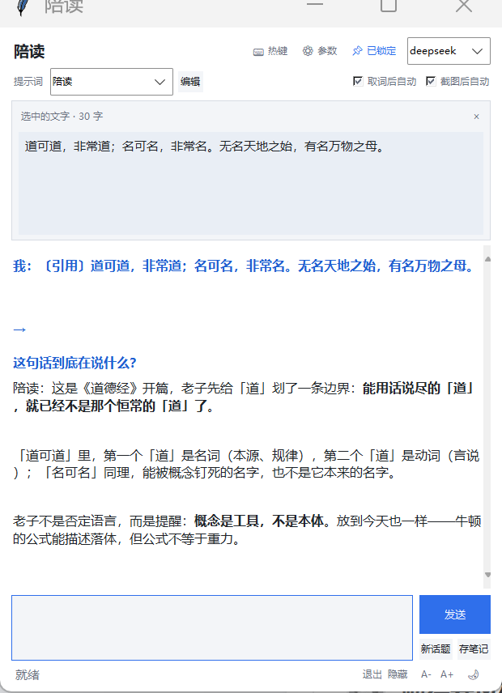

# AI 陪读小窗（便携版）

一个常驻托盘的 Windows 读书助手：**划词或框选截图 → 自动提问 → 连续追问 → 一键存进 Obsidian**。



看书时选中一段文字按 `Alt+1`，或框选一页书/一道题按 `Alt+2`，小窗自动带着上下文去问模型；答案里的公式会渲染成图片，聊完点「存笔记」直接写进笔记库（截图一起带过去）。

> 个人自用小工具，Windows 10/11 专用。界面是 tkinter，无边框特效、无 Electron，启动快、占内存小。

## 功能

- **全局热键取词 / 截图**：`Alt+1` 模拟 `Ctrl+C` 取当前选中文字；`Alt+2` 全屏框选，多显示器、125%/150% 缩放都对得齐。
- **取到就自动问**（可关）：取词、截图各一个开关，不用再点发送。
- **连续追问**：对话上下文保留，可以接着问「这句为什么这么解」「再举一例」。
- **多服务切换**：任何 OpenAI 兼容接口（DeepSeek、本地 llama.cpp / vLLM、Ollama、OneAPI…），窗口右上角下拉即切，附加请求参数支持 JSON。
- **提示词库**：内置陪读、翻译、润色、总结、拼音注音、古文今译、古文纯译、维基百科八档；可在窗口里增删改。
- **维基百科资料**：可接本地 Kiwix 服务或官方 Wikipedia（支持代理），先查资料再回答，减少胡编。
- **公式渲染**：`$...$` / `$$...$$` 用 matplotlib 画成图贴进对话，中文不会变方框。
- **存笔记**：一键写 Markdown 到 Obsidian 库，截图复制进 `attachments\` 并以 `![[...]]` 内嵌。
- **托盘常驻**：关窗/最小化收进托盘，热键随时唤出；可置顶、可反色（浅色/深色）、字号 `A-`/`A+` 可调，全部记进 `config.json`。
- **单实例**：重复双击只是把已有窗口叫到前面。

## 快速开始

### 方式一：下载便携包（推荐）

到 [Releases](../../releases) 下载 `AI陪读便携版-v1.0.0.zip`，解压到任意目录（路径别带奇怪的权限限制），然后：

- 双击 `陪读.exe`，或
- 双击 `启动陪读.bat`（用包内自带的 Python 运行源码）

首次启动会在同目录生成 `config.json`，用窗口右上角 **⚙ 参数** 填服务地址 / 模型 / API Key 即可。

### 方式二：从源码运行

需要 Windows + Python 3.13（tkinter 随官方安装包自带）：

```bat
pip install requests pillow matplotlib
python peidu.py
```

`lib\` 里放了 `pystray`（托盘）、`opencc`（简繁转换）、`PySocks`（SOCKS 代理）三个纯 Python 依赖，程序启动时会自己把它插到 `sys.path`，不用额外安装。

## 热键

| 热键 | 作用 |
|---|---|
| `Alt+1` | 取当前选中的文字并提问 |
| `Alt+2` | 框选屏幕区域（书页 / 公式 / 题目）并提问 |
| `Esc` | 隐藏窗口（程序仍在托盘） |
| `Ctrl+S` | 提示词管理窗口里保存 |

热键可在 **⌨ 热键** 里改，改完立即生效，不用重启。

## 配置

首次启动生成 `config.json`（已在 `.gitignore` 里，不会进仓库）。字段含义见 [`config.example.json`](config.example.json)：

| 字段 | 说明 |
|---|---|
| `providers` | 服务列表，键名就是下拉里显示的名字。每项含 `base` / `model` / `key` / `params`（并进请求根的附加参数） |
| `default` | 默认服务名 |
| `save_dir` | 「存笔记」写入的目录（Obsidian 库里的文件夹） |
| `hotkey_text` / `hotkey_image` | 取词 / 截图热键，如 `alt+1`、`ctrl+alt+a` |
| `auto_explain` / `auto_explain_image` | 取词 / 截图后是否自动发送 |
| `pin` | 窗口是否置顶 |
| `theme` | `light` / `dark` |
| `font_size` | 对话区字号（8–20） |
| `wiki_base` / `wiki_fallback` / `wiki_proxy` | 维基主地址 / 备用地址 / 代理，留空走直连 |

> 本机若装了 STranslate 的 OpenAI 插件，首次启动会尝试从它的配置里导入服务和 Key，省得手填。

## 目录结构

```
AI陪读便携版\
├─ peidu.py             主程序（单文件，约 2600 行）
├─ prompts.json         提示词库（可在界面里改）
├─ lib\                 便携依赖：pystray / opencc / PySocks
├─ runtime\Python313\   便携 Python（仅 Release 包里有，仓库不含）
├─ 陪读.exe             PyInstaller 单文件打包件（仅 Release 包里有）
├─ 启动陪读.bat         用自带 Python 启动源码
├─ config.example.json  配置样例
└─ images\              运行时截图缓存，退出自动清空
```

## 自己打包 exe

用系统 Python 3.13（便携运行时里没有 PyInstaller）：

```bat
"C:\Program Files\Python313\python.exe" -m PyInstaller --noconfirm --clean ^
  --onefile --noconsole --name 陪读 --distpath . ^
  --workpath %TEMP%\peidu_build --specpath %TEMP%\peidu_spec peidu.py
```

约 2 分钟出 76 MB 单文件。`pystray` / `opencc` / `PySocks` 是运行时从 `lib\` 加载的，**不要**加 `--hidden-import`。

打包后自检（GUI 程序没有 stdout，结果写到同目录文本文件）：

```bat
陪读.exe --selftest-wiki=蜀道难
陪读.exe --selftest-math
```

## 常见问题

**改了代码没生效？** 程序是单实例的，旧实例还在托盘里时，新启动只会把旧窗口叫到前面。先托盘右键「退出」，再启动。

**热键没反应？** 被别的软件占用了（常见于输入法、截图工具）。到 **⌨ 热键** 换一个组合。

**托盘图标找不到？** Win11 默认把新图标收进任务栏「^」溢出区，拖出来即可。

**截图/公式图会留着吗？** 不会。`images\` 是运行期缓存，正常退出时清空；要留的图当场点「存笔记」，会被复制进笔记目录的 `attachments\`。

## 许可

MIT，见 [LICENSE](LICENSE)。
